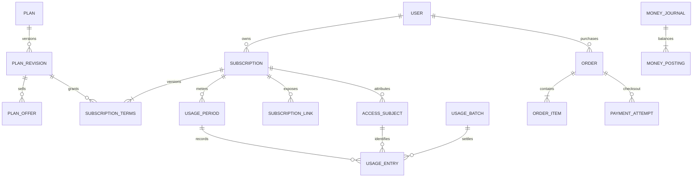

# Core Data Model v2

> 状态：Target / Draft · 更新：2026-10-12 · 本文件是逻辑数据与不变量规范，尚无对应 Models/Migrations；B1 分批实现，B3/B4 补齐流量及凭据协议，财务实现需独立验收。

## 当前数据与统一单位

真实字段来自 [User](../../../api/app/Models/User.php)、[Plan](../../../api/app/Models/Plan.php)、[Order](../../../api/app/Models/Order.php)、[OrderService](../../../api/app/Services/OrderService.php)。User 当前持有 `plan_id/group_id/expired_at/transfer_enable/u/d/uuid/token/balance/commission_balance`。模型注释标为 KB，实际订单开通将 Plan 的 `transfer_enable` 乘 `1073741824` 写入 User，因此必须按实际写入路径迁移。

| 类型 | v2 规范 | 旧数据转换 |
| --- | --- | --- |
| ID | 内部沿用 bigint 主键；跨进程数据库 ID 用规范十进制字符串传输，避免 JS 精度损失；Subject ID 不含归属语义且不可复用 | 保留 User/Plan/Order 现有 ID；映射表关联新增 ID |
| 时间 | UTC Unix seconds，64 位整数；`*_at` 可空的语义逐字段定义；区间为 `[starts_at, ends_at)` | User `expired_at=null` 表示无到期，不转换为 epoch/0；旧重置日期原值保留 |
| 日历周期 | 权益快照记录 IANA `billing_timezone`、`calendar_months` 与锚点；固定周期显式 `duration_seconds` | 旧 `OrderService.getTime` 使用 `addMonths`，不能依据 Plan 展示的 30/365 天重新计算剩余期限 |
| 金额 | `*_minor` 为有符号 64 位最小货币单位；附 ISO 4217 `currency`，不用 float；比例用整数分子/分母及固定舍入版本 | User 余额/订单金额已是 minor；当前 Plan.prices 是主单位，创建订单时 ×100。旧站点货币须从实际配置确认，不默认补成 CNY |
| 流量 | `*_bytes` 为非负 64 位整数；1 GiB = 1073741824 bytes；限速显式 `speed_limit_mbps` | User `transfer_enable/u/d` 按 bytes 原样保留；Plan 数值按 GiB 转换一次；倍率/舍入另记版本 |

JSON 中金额、流量、数据库 ID 和版本计数统一使用规范十进制字符串，不按数值大小临时混用 Number；有符号资金值允许负号，非负字段拒绝负值。UTC 秒使用 0 到 `2^53-1` 的安全整数；SQL 存储仍按 64 位类型校验。最终 DTO/Schema 需各消费端互操作验证。所有表使用原生 `tx_*` 名称，无动态表名前缀。以下 `PK/UNIQUE/FK` 是 B1/B3 实现必须满足的约束；具体 SQL 引擎索引和 CHECK 实现仍待数据库门禁验证。

## 关系

User → Subscription 为 1:N。初版业务最多一个有效订阅；未来开放多订阅只改变政策与占用约束，不能再把订阅字段放回 User。多条链接或多个 Provider Subject 默认共享所属订阅的 Usage Period，不获得额外配额。

## 商品、权益与订阅

所有可变实体有 `created_at/updated_at/row_version`；不可变实体有 `created_at/content_hash`，发布后不可 UPDATE/DELETE 业务内容。业务 FK 禁止级联删除历史，账户注销采用去标识化和受控保留。

| 表 | 主要字段及关系 | 唯一约束与不变量 |
| --- | --- | --- |
| `tx_user` | 保留 identity/password/banned/RBAC、邀请关系；旧业务字段在兼容期保留 | 邮箱约束延用当前规范；管理员/登录身份不随订阅变更 |
| `tx_plan` | `id/name/description/show/sell/renew/current_revision_id` | 商品 ID 稳定；发布指针可变，历史版本不变 |
| `tx_plan_revision` | `id/plan_id/revision_no/schema_version/group_id/quota_bytes/speed_limit_mbps/device_limit/reset_policy/billing_timezone/content_hash/published_at` | UNIQUE(plan_id, revision_no)；发布时解析“跟随系统”的实际规则并快照；NULL 限额语义显式，不用 0 兼作无限 |
| `tx_plan_offer` | `id/plan_id/plan_revision_id/offer_code/version_no/currency/price_minor/calendar_months/duration_seconds/purchase_kind/availability` | UNIQUE(plan_id, offer_code, version_no)；revision 必须属于该 plan；发布的价格/周期不变，新报价创建新行；availability 为单独可变销售状态 |
| `tx_subscription` | `id/user_id/plan_id/status/current_terms_id/starts_at/expires_at/suspended_reason/ended_at` | FK(user_id/plan_id/terms)；状态 pending/active/suspended/expired/revoked；已结束实例不重新分配给他人；`expires_at=null` 为无到期 |
| `tx_subscription_terms` | `id/subscription_id/version_no/plan_revision_id/source_order_item_id/effective_from/effective_until/quota/reset/group/speed/device 快照/content_hash` | UNIQUE(subscription_id, version_no)，生效区间不重叠；terms 引用与 subscription 归属一致；生效内容不可变 |
| `tx_subscription_terms_transition` | `id/subscription_id/previous_terms_id/next_terms_id/effective_at/business_key/created_at` | UNIQUE(previous_terms_id)、UNIQUE(next_terms_id)、UNIQUE(subscription_id,business_key)；前后 Terms 同订阅且版本递增；追加后不可改，固定生效边界 |
| `tx_subscription_slot` | `user_id/slot_no/subscription_id/reserved_at/row_version` | 初版 `slot_no=1`；PK(user_id, slot_no)、UNIQUE(subscription_id)；稳定并发锁定的数据库占位记录 |
| `tx_usage_period` | `id/subscription_id/terms_id/period_no/starts_at/ends_at/quota_bytes/upload_bytes/download_bytes/billable_bytes/status` | UNIQUE(subscription_id, period_no)；同一订阅周期不重叠；terms_id 是周期创建时的权益版本，后续快照引用当前有效 Terms，两者必须同订阅；计数器是流水投影，无历史清零；`ends_at=null` 仅不重置/无限期语义 |
| `tx_usage_adjustment` | `id/usage_period_id/terms_transition_id/business_key/kind/quota_delta_bytes/policy_version/created_at` | UNIQUE(usage_period_id,business_key)；追加不可变；kind 为 quota_change 等 allow-list，quota_delta 有符号；预算变更与周期 quota 投影同事务 |

Terms 内容和生效范围均不可就地改写。需要续费、升级、纠错时，创建后继版本和带业务幂等键的 transition；若旧 Terms 原先为开放区间，结束边界通过追加 transition 形成有效区间投影，不能悄悄修改历史快照。投影取原 effective_until 与 transition.effective_at 中较早的非空值；新 Terms.effective_from 必须等于 transition.effective_at。同一事务校验链无分叉/循环/重叠，不能用回填新的历史边界改掉已结算 usage 的归属。B1 必须验证此逻辑表的物理索引及区间查询，再实施 migration。Usage Period 重置则关闭旧周期、创建新周期；保留真实已用量，即使超过配额，展示剩余值为 `max(0, quota - used)`。

续费/改价/限速变化不能自动重置流量。同一 reset 周期内配额变化追加 usage adjustment，保留累计上传/下载；新授权快照引用新 Terms 和原 period，并以当时 quota 投影限制访问。只有经版本化旧业务规则证明需要 reset/改变重置锚点时才关闭旧周期并创建新周期。周期归属、Terms 生效和已发生 counters 分别对账，禁止因创建新 Terms 获得一次额外配额。

### 初版单有效订阅的并发规则

“有效占位”包含 active 和暂时 suspended（即使流量耗尽）；不包含 pending/expired/revoked。授权还要求用户未封禁、Terms 已生效、未到期、配额与政策允许，因此有效占位不等于此刻可用。

开通/续费/更换/管理员修改/导入必须走同一 Core 服务：事务先锁 User，再锁该用户 slot，再按固定顺序锁订阅/周期。首创 slot 遇 UNIQUE 冲突后重读，不能先查询数量再插入。判断到期并释放占位必须在同一锁内；过期清理任务迟到不能允许两个并发开通。对保留占位的 suspended 订阅，不得靠再建一个 active 绕过暂停。

新购填唯一 slot；续费更新同一实例并追加 Terms；更换计划按已验证的旧业务规则创建转换及新实例/Terms，并在同一事务转移 slot。任何并发路径都不能绕过数据库唯一约束。订单履约幂等键与 slot 更新同事务，失败全部回滚；请求重试返回同一履约结果。Future 多订阅要显式版本化调整政策与 slot 容量。

## Access Subject 与订阅链接

| 表 | 主要字段 | 约束及安全语义 |
| --- | --- | --- |
| `tx_access_subject` | `id/subscription_id/provider_id/provider_subject_ref/status/auth_version/revocation_fact_version/created_at/revoked_at` | PK(id)，UNIQUE(provider_id, provider_subject_ref)；provider ref 必须不可用于认证；subscription/provider 绑定不可改，不回收 ID；不含 UUID/password/private_key/token/raw credential |
| `tx_subscription_link` | `id/subscription_id/token_digest/digest_key_id/status/version/created_at/expires_at/revoked_at/render_policy` | UNIQUE(token_digest)；链接 bearer 原文仅发行时向已授权用户交付，Core 持久化带域隔离的验证摘要；URI 禁止入日志；链接撤销与 Subject 撤销是不同操作 |

链接授权只允许获取该订阅的有限配置，不能作为 User/Admin 会话。`render_policy` 使用 allow-list 格式 ID，不接受用户 URL/文件路径/任意脚本。使用 Core 专属链接验证密钥，不能复用 Provider 代理秘密；轮换验证密钥必须有兼容与失效窗口。旧 `User.token` 曾为私密订阅链接 token，迁移时保持原 URL 的受限映射，直到用户完成重发及兼容门禁。旋转链接默认不吊销代理凭据，旋转代理凭据默认不更改账单归属。

Subject 只标识授权和流量归属；知道 ID 不能获得访问权。被吊销 Subject 的 tombstone、历史绑定、撤销版本及 Usage Entries 持续保留，插件卸载不能把晚到批次映射到新订阅。Provider 的秘密和运行时快照材料按照 [CredentialProvider v1](../../../contracts/v2/credential-provider/README.md) 直接交付授权接收方。

## 持久批次与流量流水

| 表 | 字段 | 约束 |
| --- | --- | --- |
| `tx_tariff_revision` | `id/node_id/version_no/effective_from/effective_until/numerator/denominator/rounding_revision/content_hash` | UNIQUE(node_id,version_no)；倍率非负、分母>0；发布后不可变，生效边界不重叠 |
| `tx_auth_snapshot` | `id/node_id/source_epoch/access_subject_id/subscription_id/terms_id/usage_period_id/tariff_revision_id/auth_version/revocation_version/issued_at/lease_expires_at/policy_digest` | PK(id) 即 auth_snapshot_id；上述归属及政策在 grant 发布时冻结；lease 必须有限；不存 Provider 秘密；历史版本不可删除到无法结算 |
| `tx_usage_batch` | `id/node_id/source_epoch/batch_id/protocol_version/payload_digest/durable_payload/received_at/status/attempt_count/error_code/settled_at` | UNIQUE(node_id, source_epoch, batch_id)；相同 key+digest 返回原持久回执，不同 digest 拒绝；完整 payload、冻结快照与 outbox 原子持久化后才能 ACK |
| `tx_usage_entry` | `id/batch_id/entry_no/access_subject_id/subscription_id/usage_period_id/terms_id/auth_snapshot_id/tariff_revision_id/started_at/ended_at/raw_up_bytes/raw_down_bytes/rate_num/rate_den/rounding_revision/billable_up_bytes/billable_down_bytes/kind/reverses_entry_id` | UNIQUE(batch_id, entry_no)，此 batch_id 是表主键；Subject/Terms/周期必须同订阅并与快照绑定一致，Terms 覆盖采集时段；period 创建时 Terms 不要求等于后续快照 Terms；流水不可变；纠正通过反向/调整分录，并唯一约束每次纠正业务键 |

source_epoch 由 Core 分配并绑定安装实例与 Node 记录，不是进程 boot ID；重装可以有新 epoch，但旧 pending 保留原 epoch，不把同一批字节换身份再发。`revocation_fact_version` 是 Core 的 Subject 撤销事实版本；快照中的 `revocation_version` 则是 `(node_id,source_epoch)` 固定授权域的应用序列，两者显式映射，跨域版本不能比较。

上传和下载是原始 bytes；按每 entry 每方向 `floor(raw_bytes × numerator / denominator)` 结算，倍率/舍入固定在 tariff revision，不能随节点当前倍率重新算历史。跨周期/Terms 的观测必须可拆分；缺少足够时间证据的旧节点走明确兼容规则并标记限制，不根据接收时间臆造准确归属。入口未知 Subject/歧义映射整批拒绝且不返回 persisted；已持久批次后续发现来源缺失/异常则进入可恢复 quarantined，不能静默丢弃或自动挂到现有订阅。

同一事务锁定批次并写流水、更新周期投影、标记 settled；批次重跑不重复入账。原始 payload 按保留策略独立清理，但去重 tombstone 保留覆盖节点最大重发/离线窗口；未决批次、审计和不可变流水禁止自动清理。协议完整定义见 [Node Usage](../../../contracts/v2/node-usage/README.md)。现有 `tx_traffic_batch` 是旧 `(server_id,batch_id)` 去重基础，不等于上述持久接收实现。

## 订单、支付与资金

| 表 | 字段及关系 | 不变量 |
| --- | --- | --- |
| `tx_order` | 延用 ID/trade_no/user_id；目标追加 `currency/items_total_minor/discount_minor/surplus_applied_minor/wallet_applied_minor/provider_due_minor/fee_minor/status/row_version` | UNIQUE(trade_no)；报价冻结后不可随 Plan 改价；Legacy total_amount 是余下外部应付，不能直接当新订单商品总额 |
| `tx_order_item` | `id/order_id/line_no/kind/quantity/plan_revision_id/offer_id/target_subscription_id/terms_snapshot/unit_price_minor/gross_minor/discount_minor/net_minor/fulfilled_at` | UNIQUE(order_id,line_no)；初版 quantity=1；购买目标/货币/快照冻结；按业务键履约一次，用户归属必须匹配 |
| `tx_payment_attempt` | `id/order_id/attempt_no/provider_id/provider_account_ref/request_key/amount_minor/currency/status/provider_transaction_ref/verified_at/created_at` | UNIQUE(order_id,attempt_no)、UNIQUE(provider_id,provider_account_ref,request_key)、非空 provider transaction 全局业务唯一；尝试金额/货币不可变；允许多次尝试，但订单不能重复确认同一应付 |
| `tx_money_account` | `id/owner_type/owner_id/purpose/currency/normal_side` | UNIQUE(owner_type,owner_id,purpose,currency)；钱包/佣金/渠道清算/收入/退款/迁移期初账户分开；禁止跨币抵销 |
| `tx_money_journal` | `id/business_type/business_ref/idempotency_key/currency/status/occurred_at/posted_at/reverses_journal_id` | UNIQUE(business_type,business_ref,idempotency_key)；draft → posted 原子完成；posted 不可改/删；更正新增冲销和新凭证 |
| `tx_money_posting` | `id/journal_id/line_no/account_id/side/amount_minor` | UNIQUE(journal_id,line_no)；amount>0，side=debit/credit；账户货币必须等于 journal.currency |

资金 journal 至少两笔 posting；每一币种 `sum(debit)=sum(credit)` 才能提交。复式平衡不是业务余额充分的证明，扣钱包还须锁账户、检查可用余额与保留金额。钱包余额、佣金余额和渠道待结算余额是 posted postings 的投影，投影与流水更新在同一事务。钱包消费可采用保留账户转移，取消仅释放一次；不得将预扣和最终消费都记成两次收入。

订单等式：`sum(item.gross)-discount=items_net`，`items_net-surplus_applied-wallet_applied=provider_due>=0`；外部收款验证 `provider_due+fee`，折抵超过价格的部分单独入 wallet credit journal。旧 amount 字段迁移前逐项验证实际折扣/折抵语义，不能靠总额相同掩盖分类错误。免费/全余额订单没有虚构支付商交易，仍需要一次履约和合法账本分录。

支付回调在验签后由 Core 再次检查 Provider、账户、币种、金额、订单状态、交易唯一性。多尝试成功竞态在订单锁内裁决；额外真实收款保留成待退款/待核对清算负债，不二次开通，不删除成功交易。支付事实、journal、订单转换及 outbox 同事务；队列失败可重发事件。退款使用引用原收款/原账本的独立 journal，并检查累计退款不超原可退款额。渠道凭据不进入 Core JSON 配置或日志。

## 迁移与验收约束

旧字段回填、权威写入切换和故障恢复按 [Core 演进](core-evolution.md)执行。新模型不允许全站一次 destructive migration，不删除旧表，不重新引入旧前缀切换或自动旧站点导入命令。

B1 验收至少覆盖：缺失 Plan、永久/已过期/封禁、超用量、重置边界、自定义 User 权益、并发开通/续费/升级/管理员修改、旧订阅 URL、金额精度、已折抵订单和重试。B3 补齐节点跨期/离线/重复和冲突批次故障注入；支付与复式账本上线前必须单独通过竞态、重复回调、双成功尝试、取消/退款与余额对账。逻辑规范不替代这些测试或生产数据演练。
