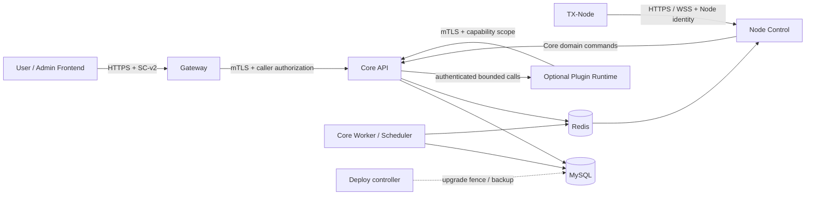

# Core v2 Runtime Topology

状态：**Target / Draft**。B0 部署角色与信任边界，后续由 B2/B4/B5/B6/B8 实现和验证；不代表当前 Compose 已支持三种模式。现有 TXBoard 集成 Octane、queue、Workerman 与前端，v1 PHP Plugin 仍是进程内可信代码；本文件只定义目标拓扑，不将它们描述为已隔离。

## 1. 必须存在的逻辑角色

| 角色 | 持有与职责 | 外部可达性 |
| --- | --- | --- |
| Core API | 账户、订阅、资金、权益、RBAC 和 Internal API 的唯一业务权威 | 内部业务接口仅可信服务网络；支付回调使用独立认证入口 |
| Core Worker / Scheduler | 持久 usage/outbox 结算、业务任务、恢复扫描和调度 | 无公网端口，写入仍遵守同一领域服务/schema epoch |
| Node Control | 原生 HTTP/WSS 接收、认证、授权快照和撤销同步；委托 Core 持久命令处理器 | 仅节点入口公网可达，Node/Machine 专用身份 |
| Gateway | User/Admin Web API、SC-v2、操作白名单、DTO 适配 | HTTPS 公网入口；访问 Core 使用服务身份加真实调用者上下文 |
| MySQL | 权威账本、持久接收、映射、检查点/栅栏（部署确定存储绑定） | 私网，限制连接身份与备份身份 |
| Redis | 队列唤醒、缓存、实时控制分发、SC 防重放 | 私网按 key/命令隔离，不作为流量账本和接收 ACK 真相 |
| Deploy 控制器 | 版本预检、互斥、备份、迁移编排与恢复 | 按需运行的受限运维身份，所有业务组件不能调用通用 shell |
| User/Admin Frontend | 静态应用、标准 SDK、独立构建版本 | HTTPS/CDN，浏览器不持有 Core 服务私钥 |
| TX-Node | 数据面、租约授权、稳定批次、持久 pending | 独立主机/部署，通过 Node Control 主动 HTTP/WSS 连接 |

部署一个完整可访问平台必须运行上述服务角色；纯 Core 的无插件启动验收可以不启用 Gateway/前端，但不能宣称具备完整 Web 入口。Credential Provider、支付 Provider、通知 是可选插件 Runtime；无 Credential Provider 时 Core 仍可管理账户/订单/套餐/节点，发行新的代理访问凭据返回能力不可用。

图中调用是逻辑边界，Node Control 可与 Core 共用部署制品；Redis 的通知无法替代 SQL outbox。Provider 配置含秘密，仅限受权节点的短期配置通道，禁止在 Gateway、管理清单、usage ledger 和观测日志中复制。

## 2. Compact、Standard、Cluster

| 模式 | 必需角色的进程与分布 | 安全及可靠性最低要求 |
| --- | --- | --- |
| Compact | 一台控制平面主机，Core API、Worker/Scheduler、Node Control 可由同一制品的受监督进程承载；Gateway、MySQL、Redis 各自服务进程；前端可由反代或 CDN 托管；Deploy 按需运行 | 同机仍执行独立服务身份和 mTLS；插件独立进程/容器；持久卷、备份及 Node pending 不能省略。单机停机是明确故障域 |
| Standard | 一套控制平面部署，Core API、Worker、Node Control、Gateway 独立进程/容器，可分主机；数据库和 Redis 私网，前端独立托管 | 可以分别扩缩 Worker 与连接管理；只有一个有效调度 leader，升级须统一排空全部角色 |
| Cluster | 多 Core API/Gateway/Node Control/Worker 实例；共享 MySQL 权威与 Redis；调度 leader、共享制品与秘密管理；Deploy 使用集群栅栏 | 实例无本地业务真相，唯一约束/租约/fencing 必须跨实例；MySQL/Redis 高可用和备份恢复分别验证，不由应用副本数量推断 |

三种模式保留相同契约和授权，Compact 减少进程/部署数量不放宽边界。Node 是数据面，不要求与控制平面同机；Node pending 和本地密钥必须位于 Installer 管理的持久卷。未核查本地缺失的 TX-Node-Installer，不能把该卷、Node 自动滚动升级或恢复能力写成已验证事实。

## 3. 身份、数据库与私网

Gateway、Node Control（独立部署时）、Plugin Runtime 各有可轮换服务证书、允许调用操作及范围；mTLS 校验可信链、SAN 服务身份、有效期和撤销，不使用单个共享管理员 Token。Gateway 的服务身份不等于浏览器 User/Admin 身份：Core 继续验证真实调用者、RBAC、目标范围和审计；不能仅相信可伪造的转发 header。详见 [Core Internal API](../../../contracts/v2/core-internal-api/README.md)。

Core/Worker 使用最小数据库权限；迁移使用临时独立 DDL 运维身份，备份使用独立只读/恢复身份。Gateway/Frontend/Agent/MCP 无 Core MySQL 写入或节点管理凭据。插件私有存储用独立库/目录和独立凭据，Core 稳定 subject 与账本不交给插件删除。Compact 中进程隔离本身不是沙箱：v2 Runtime 仍须非 root、最小网络/文件权限、禁止 Docker socket/宿主根目录、限 CPU/内存/FD/并发及请求超时；需要强隔离的第三方插件使用满足这些策略的容器运行。

Redis 中业务队列/控制分发与 Gateway 防重放使用独立 ACL/key 空间。防重放状态缺失、Redis 不可用或淘汰策略危及去重时，SC-v2 失败关闭；不能清库后继续接受仍有效旧加密消息。usage 队列丢失由 SQL pending/outbox 扫描恢复。控制通知丢失由租约过期、全量授权同步和 revocation version 修复，不能依赖 pub/sub 永不丢消息。

## 4. Node Control 与 Plugin 生命周期

Node/Machine 使用各自身份且绑定分配范围；公网 Node TLS 验证不能关闭。是否将 Node 服务认证迁移为 mTLS 要由独立版本协议决定，不把 Gateway 的 mTLS 自动套给现有 Node Bearer。Node Control HTTP/WSS 执行同一鉴权、持久接收和回执逻辑，WSS 是独立连接角色，Laravel `route:list` 不证明其已运行。

授权快照短期租约和单调撤销版本必须在 Node 持久保存。断连可在未到期租约内按策略继续，到期立即停止该授权的准入及连接；重连先比较已应用版本，漏版本则全量同步。Provider 崩溃不能延长租约；卸载通过停止发行、撤销、确认/等待租约、排空历史批次，再删除插件活动秘密数据。历史 `access_subject_id` 和 usage/money ledger 保留。无法确认旧节点撤销时阻断安全卸载，强制路径须保留可见审计风险，不能显示“已全部即时撤销”。详见 [Credential Provider](../../../contracts/v2/credential-provider/README.md) 与 [Node Usage v2](../../../contracts/v2/node-usage/README.md)。

v1 Plugin 保留显式兼容 Runtime 并标记 trusted-in-process，逐插件迁移到 v2 独立进程，不能自动把现有 PHP 包作为“不可信但已隔离”运行。v2 插件启动/崩溃/卸载不影响 Core readiness，相关产品能力单独 degraded；生命周期状态和实际健康由 Core 观测，不能相信 manifest 自报。

## 5. 轻量运行与验证

Compact 先以少量受监督 Worker、按需插件启动、连接池上限、批量结算和背压控制开销；仅启用已安装并需要的插件，不为每个订阅创建进程。Core API 和 Worker 共享领域代码及事务规则，通过角色开关决定运行职责，不在 Gateway/插件复制业务状态。所有长驻进程定义缓存作用域、失效、证书轮换与升级重启方式，符合 Octane 的请求隔离要求。

本轮没有容量压测证据，不给出最低内存或吞吐承诺。B8 对每种模式记录确切硬件、组件版本、并发订阅/连接、批次大小与节奏、数据库规模、CPU/RSS、延迟分位数、恢复积压耗时及成本，发布可复现实测结果再给资源建议。

readiness 分别暴露 Core DB/epoch、Worker 扫描/结算进度、Node Control 授权撤销覆盖、Gateway mTLS/SC 防重放；liveness 避免因可选 Provider 故障不停重启 Core。观测标识限 request/batch/subject/节点 ID，秘密配置和个人数据脱敏。必须验证：同机身份伪造拒绝、租约到期停止授权、Redis 丢失可恢复 usage、双 Worker 不重复计费、插件资源耗尽不拖垮 Core、Cluster 双升级执行者被栅栏阻断。

升级与恢复按 [Upgrade Manifest](../../../contracts/v2/upgrade-manifest/README.md) 执行。B8 完成之前，三种拓扑只能标记为目标设计；不能以 Docker 服务健康替代跨组件业务、恢复及安全验收。
