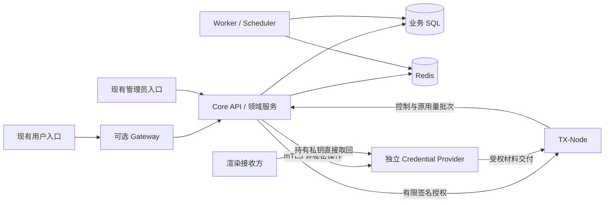

# Core 运行拓扑

> 更新：2026-10-16 · 当前基线：C1/C2 已合并。
>
> 本页区分实际运行角色和未来部署形态。Compact、Standard、Cluster 是目标分布，不表示当前 Compose 或安装器已经完整支持三种模式。

## 当前运行角色

Core API、Worker、Scheduler、Node HTTP 与 Workerman WSS 共用 Core 领域代码和 SQL 权威，角色可以同制品部署。Gateway 是独立可选用户 BFF，尚未统一接管管理员入口。Credential Provider 是独立 Go 进程，有自己的私有存储及客户端身份；TX-Node 是独立数据面。

| 角色 | 当前持有与职责 | 当前边界 |
| --- | --- | --- |
| Core API | 账户、目录、订单、订阅、授权、接收与结算 | 持久 native/open 后只开放已支持入口；C2 免费 Offer，C3 资金待完成 |
| Worker / Scheduler | 持久任务恢复、履约、生命周期、凭据同步和用量结算 | 与 API 使用相同安装记录、epoch 和事务规则 |
| Node Control | 原生 HTTP/WSS、认证、快照与刷新通知 | HTTP 在 Core；WSS 由独立 Workerman 连接角色管理，Node/Machine 身份独立 |
| Credential Provider | 签发/查询/轮换/撤销，向 Node 或渲染客户端直接交付材料 | 私有 bbolt；Core/Node mTLS 身份分离；不是由 Node 服务隐式启动 |
| TX-Node | 内核准入、有限授权、计量、持久 pending 与重报 | C2 为 Linux sing-box VLESS/VMess direct TCP；原 Session/Period 不重贴 |
| Gateway | 用户 BFF、闭合 operation、DTO/envelope 适配 | 不持有业务数据库；正式 Internal API/Admin 入口仍属 C4 |
| SQL / Redis | SQL 保存业务事实、预留、账本和 outbox；Redis 队列/缓存/通知 | Redis 不作为持久接收 ACK 或计费真相 |
| Frontend / Deploy | 现有入口仍存在；新增前端由 TX-F，安装器由 TXBoard-Deploy | 新前端延期；安装更新发布在 C5 收口 |

这是逻辑关系图，不是已发布的安装清单。Core 中现有 PHP Plugin 仍是可信进程内代码，不能从独立 Provider 推断全部插件已隔离。Agent/MCP 已退役，不属于拓扑角色。

## 目标部署形态

| 模式 | 目标分布 | 尚需交付或验证 |
| --- | --- | --- |
| Compact | 单控制平面主机；API、Worker、Scheduler、Node Control 可用同一制品的受监督进程；SQL、Redis、Gateway、Provider 按独立服务部署 | C5 可重复安装、固定版本更新、备份恢复和持久目录；同机不能省略身份隔离或将 Provider 秘密交给 Core |
| Standard | API、Worker、Node Control、Gateway、Provider 独立进程/容器，可分主机；SQL/Redis 在私网，前端独立托管 | 独立扩缩、调度单 leader、生产信任和统一排空；不以单机 CI 视为已验证 |
| Cluster | 多 API/Gateway/Node Control/Worker，共享 SQL 权威、Redis 分发及统一制品/秘密管理 | 跨实例锁/租约/fencing、调度、共享状态、数据库/Redis HA 和故障恢复；当前未完成 |

Node 不要求与控制平面同机；安装器管理 Node 的持久配置、密钥、授权高水位和原批次目录。现有备份恢复切片是可复用基础，不代表完整版本交付或全协议恢复矩阵已完成。

## 不因部署方式改变的边界

- Gateway 的服务身份不能代替 User/Admin；Core 重验每次调用的权限与归属。Node/Machine、支付回调与管理员凭据互不借用。
- Provider 持有代理秘密；Core 只持非秘密承诺/回执。秘密不进入 Gateway、管理清单、SQL 用量账本或日志。
- 同机部署仍需独立服务身份、最小文件/网络权限与超时；第三方插件进程隔离及资源策略仍属目标，不能声称 PHP 插件已有沙箱。
- Worker 对持久安装及 epoch 逐项准入；旧进程不得因缓存或配置降级继续写入。可丢弃开发环境可以整体重建，不能用旧状态冒充新安装授权。
- 队列及通知丢失由 SQL 接收/outbox、全量刷新和有限租约恢复；Node 到期关闭，Provider 失联不延长授权。
- 接收、预留、结算各有真实状态；重启和轮换不清除原周期未结算额度。

生产 PKI、信任/证书轮换、正式 Internal API 和长期链接在 C4 完成；单机安装发布在 C5 完成。Cluster、完整协议/平台及容量承诺另行安排，不阻塞当前 C3 开发。

## 开发与验证

开发主线只支持当前 native 契约，不要求 legacy→shadow→native 迁移部署。现存旧分支按相关批次清理，不新增兼容 Runtime。旧站迁移未来按独立需求处理。

本地只做必要静态检查；真实进程、数据库、流量、race 和构建集中在 CI。仅文档或拓扑说明修改不重跑业务矩阵。当前没有三种拓扑的完整容量实测，不给出最低内存、吞吐或 HA 承诺。依据见[当前接口矩阵](compatibility-matrix.md)、[C2 运行契约](../../../contracts/v2/native-c2-runtime-v1.md)和[交付计划](core-completion-plan.md)。
